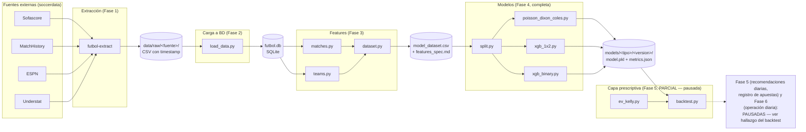
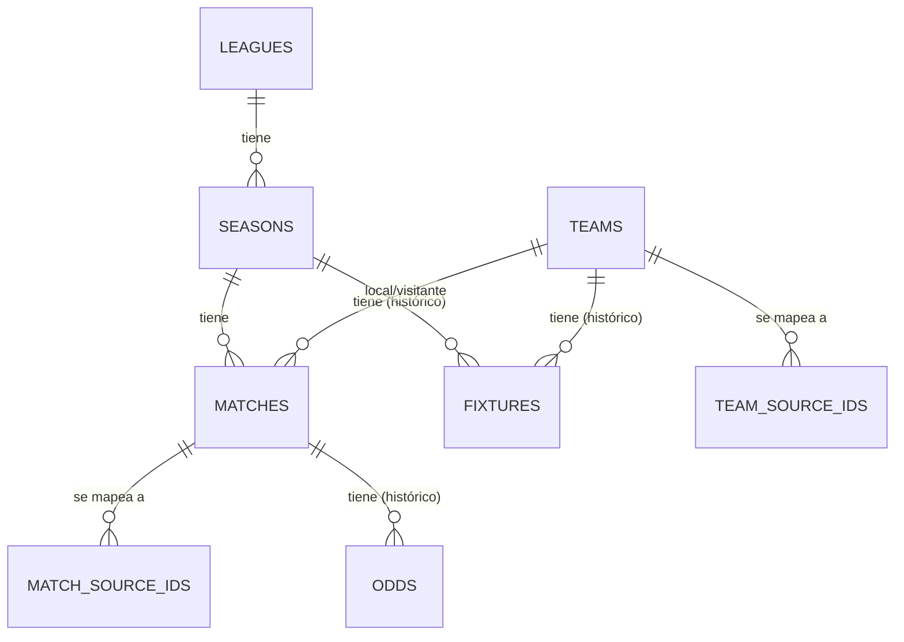

# Arquitectura del sistema — Fútbol

*Última actualización: 11 nov 2026. Nivel intermedio: más técnico que
`INFORME_PROYECTO.md`, menos detallado que `AGENTS.md` (ahí está la
referencia exacta función por función). Pensado para entender cómo
está armado el sistema sin tener que leer el código.*

## Visión general

## Las 4 fuentes de datos y qué aporta cada una

| Fuente | Qué trae | Particularidad |
|---|---|---|
| **Sofascore** | Calendario, resultados, tabla de posiciones | Es la fuente "ancla": todas las ligas/temporadas se definen en términos de sus códigos (`ENG-Premier League`, `2425`). |
| **MatchHistory** (football-data.co.uk) | Resultados históricos y cuotas de más de 20 casas de apuestas | Sin ningún id propio — solo nombres de equipo (y abreviados: "Wolves", "Man Utd"). Hora de los partidos en hora local de Reino Unido, no UTC (ver más abajo). |
| **ESPN** | Calendario, de respaldo/cruce | No trae marcador en la integración actual — solo sirve para confirmar identidad de partidos, no para cargar resultados. |
| **Understat** | Estadísticas avanzadas (xG) | Única fuente que trae un id propio de equipo junto al nombre. Su xG sí se carga a la BD desde el 11 nov (`matches.home_xg`/`away_xg`, ver abajo). |

Ninguna de las 4 comparte un identificador común de equipo o de
partido entre sí — ese fue el primer problema de diseño real de la
Fase 2 (detalle en `INFORME_PROYECTO.md`).

## Esquema de la base de datos

Nueve tablas, en `db/schema_v4.sql` (versión vigente — `v1`-`v3` quedan
como historial, nunca se editan):

- **`leagues`/`seasons`** — catálogos simples. Las 4 fuentes SÍ
  comparten el código de liga/temporada (es una convención propia de
  `soccerdata`, no de cada proveedor), así que no necesitan tabla de
  mapeo.
- **`teams`/`matches`** — catálogos **canónicos**, con su propio id
  interno (no tomado de ninguna fuente), porque ninguna fuente tiene
  un id o nombre que las otras 3 reconozcan. `matches.home_xg`/
  `away_xg` (agregado en v4, 11 nov) son la excepción al "historial
  completo" de abajo: se sobrescriben igual que el marcador, porque el
  xG de un partido ya jugado es un hecho fijo, no algo que cambie con
  el tiempo como una cuota.
- **`team_source_ids`/`match_source_ids`** — tablas de mapeo: por cada
  fuente, qué nombre/id usa esa fuente para referirse a un equipo o
  partido canónico. Resuelven el problema de "Wolverhampton" /
  "Wolverhampton Wanderers" / "Wolves" siendo el mismo equipo.
- **`fixtures`** (tabla de posiciones) y **`odds`** (cuotas) —
  guardan **historial completo**, no el último valor: cada captura es
  una fila nueva, marcada con `captured_at` (el momento de la
  extracción, no de la carga a la BD). Decisión de Carlos, pensada
  para que un modelo futuro pueda usar "cómo venía cambiando la cuota"
  o "en qué posición estaba el equipo antes de este partido", no solo
  el dato más reciente. `odds` cubre 3 mercados (`market`: `1x2`,
  `over_under_2.5`, `asian_handicap`) y distingue cuota pre-cierre de
  cuota de cierre (`is_closing`) — la de cierre es la que se usa como
  feature de los modelos (Fase 4) y para el backtest (Fase 5), porque
  es la última disponible antes de que el mercado deje de aceptar
  apuestas.
- **`pipeline_runs`** — pensada para la Fase 6 (que el proceso corra
  solo todos los días); todavía no se usa, pero ya está en el esquema
  para no tener que migrarlo después.

## Pipeline de carga (orden y por qué)

1. `load_leagues` / `load_seasons` — catálogos, `INSERT OR IGNORE`
   (no cambian entre corridas).
2. `load_matches` — para cada partido: resuelve equipos (`resolve_team`,
   usa `config/team_aliases.json`), resuelve identidad del partido
   contra otras fuentes **con una ventana de ±6 horas** (no hora
   exacta, por el desfase de huso horario de MatchHistory), y
   sobrescribe el marcador con el valor más reciente (`upsert_match_result`
   — a diferencia de `odds`/`fixtures`, el resultado de un partido no
   tiene historial que valga la pena guardar).
3. `load_odds_1x2` / `load_odds_extra_markets` — cuotas de los 3
   mercados (1x2, over/under 2.5, hándicap asiático), una fila nueva
   por corrida de extracción (histórico).
4. `load_fixtures` — tabla de posiciones, mismo patrón de histórico
   que las cuotas. La posición se calcula por el orden de fila que ya
   trae Sofascore, no se recalcula con un criterio propio.
5. `load_xg` — xG real de Understat a `matches.home_xg`/`away_xg`
   (agregado 11 nov). Upsert real, no histórico (ver arriba).

Cada paso tiene su propio módulo en `src/futbol/db/`, y
`validate_data.py` corre después para confirmar que no hay
duplicados, fechas imposibles, marcadores negativos ni referencias
rotas entre tablas.

## Capa de features (Fase 3)

Tres módulos en `src/futbol/features/`, cada uno construido sobre el
anterior:

1. **`matches.py`** — qué pasó en cada partido (resultado, goles,
   over/under, BTTS). Estas columnas son el **objetivo** a predecir,
   nunca una entrada de un modelo.
2. **`teams.py`** — cómo venía cada equipo *antes* de ese partido
   (promedios de los últimos 5 partidos, racha). Estas son las
   **predictoras**. El cuidado central acá es no mirar el resultado
   del propio partido al calcular su "antes" — verificado con un
   escenario de prueba calculado a mano, no solo confiado al código.
3. **`dataset.py`** — une las dos anteriores (más `odds.py`, ver
   abajo) y las separa explícitamente en `predictor_columns()` vs.
   `TARGET_COLUMNS`, con un test que rompe si alguna vez esas dos
   listas se superponen por error.
4. **`odds.py`** (agregado 11 nov) — probabilidad implícita de la
   cuota de cierre promedio (mercados 1x2 y over/under 2.5), sin el
   margen de la casa ("devigging"). No es fuga de datos: la cuota de
   cierre se fija antes del partido.

## Capa de modelos (Fase 4, completa)

Tres enfoques distintos sobre el mismo `model_dataset.csv`,
`src/futbol/models/`:

- **`split.py`** — divide el dataset 70/15/15 por fecha (nunca al
  azar) en `train`/`val`/`test`, con overlap de fechas garantizado en
  cero entre splits.
- **`poisson_dixon_coles.py`** — un modelo estadístico (MLE) por
  `(liga, temporada)`, ajustado directo sobre los goles — no consume
  `predictor_columns()` ni ninguna feature de equipo o de mercado.
- **`xgb_1x2.py`/`xgb_binary.py`** — XGBoost sobre
  `predictor_columns()` (forma de equipo + xG + cuotas de mercado),
  calibrado con el split `val` (sigmoide/Platt — la isotónica del plan
  original resultó inestable con este tamaño de muestra, ver
  `docs/xgb_1x2_resultados.md`) y evaluado en `test`.

**Resultado real, verificado contra una línea base trivial en los 3
enfoques** (predecir siempre la tasa histórica): 1X2, "más de 1.5
goles" y "más de 2.5 goles" tienen ventaja real; "ambos equipos
marcan" no. Detalle en `docs/xgb_1x2_resultados.md`,
`docs/xgb_binary_resultados.md`, `docs/dixon_coles_resultados.md`.

## Capa prescriptiva (Fase 5, PARCIAL — pausada por un hallazgo real)

`src/futbol/betting/`:

- **`ev_kelly.py`** — valor esperado (`prob_modelo * cuota - 1`) y
  Kelly fraccionado (mitad de Kelly, tope 5% del banco por apuesta).
- **`backtest.py`** — simula apostar según esas fórmulas contra cuotas
  REALES de cierre sobre el split `test`.

**Por qué queda en "parcial"**: el backtest mostró que la estrategia
pierde dinero de forma severa (-85% del banco simulado en 1X2, -49%
en over/under 2.5) — el edge medido contra la línea base trivial (capa
de modelos) no es el mismo tipo de edge que hace falta para apostar
rentablemente contra el mercado que en parte lo generó. Detalle
completo, con la verificación de que no es un bug, en
`docs/backtest_resultados.md`. **No se construyó el resto de Fase 5**
(recomendaciones diarias, registro de apuestas) sobre esta base ya
demostrada perdedora — decisión de Carlos: pausar mientras se busca
una señal genuinamente independiente del mercado.

## Decisiones de diseño que vale la pena recordar

- **El esquema se versiona como archivo completo** (`schema_v1.sql`,
  `v2`, `v3`, ...), nunca editando uno ya pusheado — así queda un
  historial de cómo evolucionó, en vez de perder el rastro.
- **Resolución de equipos a mano, no por algoritmo de coincidencia
  aproximada** — con nombres de equipo cortos y parecidos entre sí
  (Manchester United / Manchester City), un algoritmo así arriesga
  confundir dos equipos sin que nadie lo note.
- **Identidad de partidos por ventana de tiempo, no por hora exacta**
  — por el desfase de huso horario ya mencionado.

## Limitaciones conocidas

Ver `INFORME_PENDIENTES.md` para el detalle completo. Las más
importantes hoy:

- **No hay cuota de mercado de over/under 1.5** en este dataset (solo
  1x2 y over/under 2.5) — el modelo `xgb_over_1_5` tiene buena métrica
  pero no se puede backtestear ni operar sin esa cuota real.
- **BTTS (ambos equipos marcan) no tiene ventaja real** sobre la línea
  base trivial, ni con xG ni con las cuotas de mercado disponibles.
- **La Fase 5 (capa prescriptiva) está pausada**: el enfoque "apostar
  cuando el modelo ve valor esperado positivo" se backtesteó contra
  cuotas reales y pierde dinero — no es un problema de código, es que
  el edge de los modelos (medido contra una línea base trivial) no es
  el mismo tipo de edge que hace falta para apostar rentablemente
  contra el mercado.
