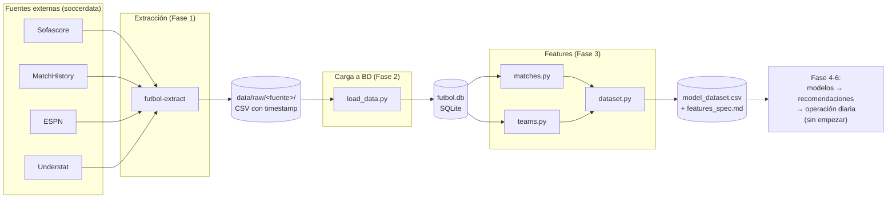
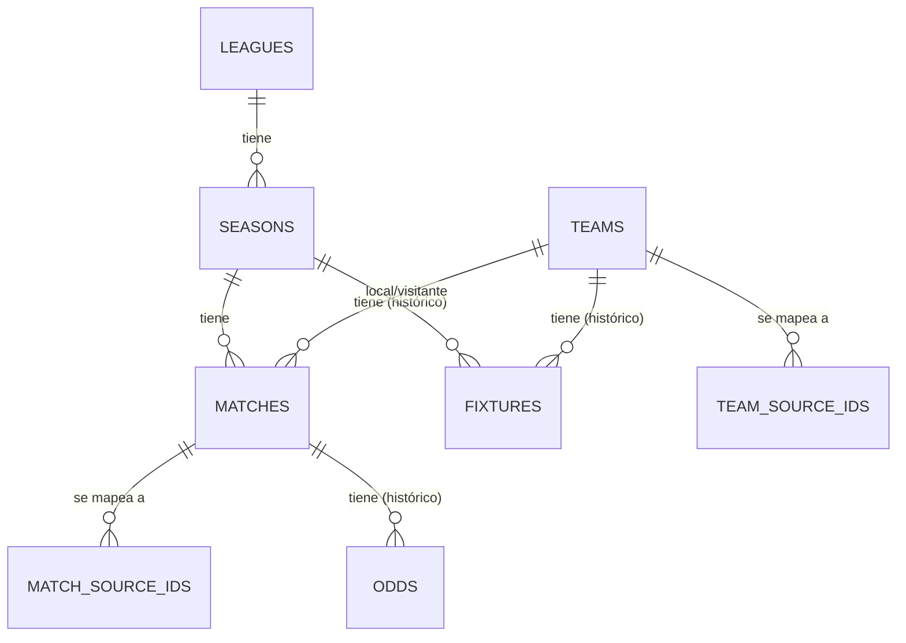

# Arquitectura del sistema — Fútbol

*Última actualización: 4 nov 2026. Nivel intermedio: más técnico que
`INFORME_PROYECTO.md`, menos detallado que `AGENTS.md` (ahí está la
referencia exacta función por función). Pensado para entender cómo
está armado el sistema sin tener que leer el código.*

## Visión general

## Las 4 fuentes de datos y qué aporta cada una

| Fuente | Qué trae | Particularidad |
|---|---|---|
| **Sofascore** | Calendario, resultados, tabla de posiciones | Es la fuente "ancla": todas las ligas/temporadas se definen en términos de sus códigos (`ENG-Premier League`, `2425`). |
| **MatchHistory** (football-data.co.uk) | Resultados históricos y cuotas de más de 20 casas de apuestas | Sin ningún id propio — solo nombres de equipo (y abreviados: "Wolves", "Man Utd"). Hora de los partidos en hora local de Reino Unido, no UTC (ver más abajo). |
| **ESPN** | Calendario, de respaldo/cruce | No trae marcador en la integración actual — solo sirve para confirmar identidad de partidos, no para cargar resultados. |
| **Understat** | Estadísticas avanzadas (xG) | Única fuente que trae un id propio de equipo junto al nombre. Su xG todavía no se carga a la BD (ver `INFORME_PENDIENTES.md`). |

Ninguna de las 4 comparte un identificador común de equipo o de
partido entre sí — ese fue el primer problema de diseño real de la
Fase 2 (detalle en `INFORME_PROYECTO.md`).

## Esquema de la base de datos

Ocho tablas, en `db/schema_v3.sql` (versión vigente — `v1`/`v2` quedan
como historial, nunca se editan):

- **`leagues`/`seasons`** — catálogos simples. Las 4 fuentes SÍ
  comparten el código de liga/temporada (es una convención propia de
  `soccerdata`, no de cada proveedor), así que no necesitan tabla de
  mapeo.
- **`teams`/`matches`** — catálogos **canónicos**, con su propio id
  interno (no tomado de ninguna fuente), porque ninguna fuente tiene
  un id o nombre que las otras 3 reconozcan.
- **`team_source_ids`/`match_source_ids`** — tablas de mapeo: por cada
  fuente, qué nombre/id usa esa fuente para referirse a un equipo o
  partido canónico. Resuelven el problema de "Wolverhampton" /
  "Wolverhampton Wanderers" / "Wolves" siendo el mismo equipo.
- **`fixtures`** (tabla de posiciones) y **`odds`** (cuotas) —
  guardan **historial completo**, no el último valor: cada captura es
  una fila nueva, marcada con `captured_at` (el momento de la
  extracción, no de la carga a la BD). Decisión de Carlos, pensada
  para que un modelo futuro pueda usar "cómo venía cambiando la cuota"
  o "en qué posición estaba el equipo antes de este partido", no solo
  el dato más reciente.
- **`pipeline_runs`** — pensada para la Fase 6 (que el proceso corra
  solo todos los días); todavía no se usa, pero ya está en el esquema
  para no tener que migrarlo después.

## Pipeline de carga (orden y por qué)

1. `load_leagues` / `load_seasons` — catálogos, `INSERT OR IGNORE`
   (no cambian entre corridas).
2. `load_matches` — para cada partido: resuelve equipos (`resolve_team`,
   usa `config/team_aliases.json`), resuelve identidad del partido
   contra otras fuentes **con una ventana de ±6 horas** (no hora
   exacta, por el desfase de huso horario de MatchHistory), y
   sobrescribe el marcador con el valor más reciente (`upsert_match_result`
   — a diferencia de `odds`/`fixtures`, el resultado de un partido no
   tiene historial que valga la pena guardar).
3. `load_odds_1x2` — cuotas del mercado 1x2, una fila nueva por
   corrida de extracción (histórico).
4. `load_fixtures` — tabla de posiciones, mismo patrón de histórico
   que las cuotas. La posición se calcula por el orden de fila que ya
   trae Sofascore, no se recalcula con un criterio propio.

Cada paso tiene su propio módulo en `src/futbol/db/`, y
`validate_data.py` corre después para confirmar que no hay
duplicados, fechas imposibles, marcadores negativos ni referencias
rotas entre tablas.

## Capa de features (Fase 3)

Tres módulos en `src/futbol/features/`, cada uno construido sobre el
anterior:

1. **`matches.py`** — qué pasó en cada partido (resultado, goles,
   over/under, BTTS). Estas columnas son el **objetivo** a predecir,
   nunca una entrada de un modelo.
2. **`teams.py`** — cómo venía cada equipo *antes* de ese partido
   (promedios de los últimos 5 partidos, racha). Estas son las
   **predictoras**. El cuidado central acá es no mirar el resultado
   del propio partido al calcular su "antes" — verificado con un
   escenario de prueba calculado a mano, no solo confiado al código.
3. **`dataset.py`** — une las dos anteriores y las separa
   explícitamente en `predictor_columns()` vs. `TARGET_COLUMNS`, con
   un test que rompe si alguna vez esas dos listas se superponen por
   error.

## Decisiones de diseño que vale la pena recordar

- **El esquema se versiona como archivo completo** (`schema_v1.sql`,
  `v2`, `v3`, ...), nunca editando uno ya pusheado — así queda un
  historial de cómo evolucionó, en vez de perder el rastro.
- **Resolución de equipos a mano, no por algoritmo de coincidencia
  aproximada** — con nombres de equipo cortos y parecidos entre sí
  (Manchester United / Manchester City), un algoritmo así arriesga
  confundir dos equipos sin que nadie lo note.
- **Identidad de partidos por ventana de tiempo, no por hora exacta**
  — por el desfase de huso horario ya mencionado.

## Limitaciones conocidas

Ver `INFORME_PENDIENTES.md` para el detalle completo (xG sin cargar,
mercados de cuotas sin implementar, y por qué ninguno de los dos
bloquea el resto del trabajo).
